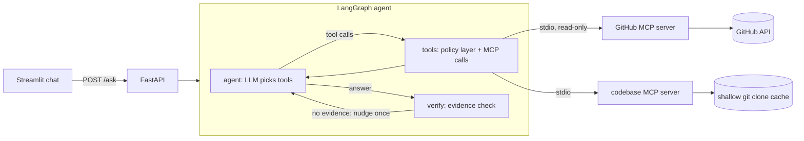

# RepoScout

Ask questions about any public GitHub repository and get answers with clickable sources.

> "How are retries configured in HTTPAdapter?" → *`DEFAULT_RETRIES = 0`; pass `max_retries=Retry(...)`*, with a link to `src/requests/adapters.py#L78-L84`
> "What changed in the last release?" · "Are there open issues about proxies?" · "Summarize the most recently merged pull request"

An **agentic** LangGraph workflow decides which tools to call, through **two MCP servers**:

| MCP server | Who built it | Used for | Tools |
|---|---|---|---|
| `github` | GitHub (official `github-mcp-server`, read-only) | issues, pull requests, commits, releases | 9 allow-listed read tools |
| `codebase` | this project (`FastMCP`) | the code itself: shallow clone, grep, line-range reads | `repo_overview`, `list_files`, `grep_code`, `read_file` |

Runs on free models: a local **Ollama** model, or any OpenAI-compatible endpoint (e.g. Groq with `gpt-oss-20b`).



## What makes it more than a demo

- **Scope by construction.** `owner`/`repo` are removed from every tool schema the LLM sees and injected by code. The model cannot even express "read another repository", and search qualifiers like `repo:` are blocked. That matters because the GitHub MCP server's own scoping is skipped when a query already has a `repo:` qualifier (see `tool_policy.py`).
- **Read-only three times over:** the server runs with `GITHUB_READ_ONLY=1` and an explicit tool list, the client registers only tools annotated `readOnlyHint`, and the token only needs public read access.
- **Built for small models:** slim schemas, argument repair (`"open"` → `"OPEN"`, `"42"` → `42`), compact defaults (10 items, no bodies), bounded output (200 lines per read, 6,000 characters per result), and "did you mean" hints on wrong paths.
- **No answers from memory:** a deterministic `verify` node accepts an answer only if at least one tool call succeeded; otherwise it nudges once, then refuses.
- **Citations from evidence:** sources are built from the tool calls that ran (file + line range, issue, PR, commit), not from the model's text.
- **Production basics:** long-lived MCP sessions (33 ms per call instead of 637 ms per new session), graceful degradation when a server is down, tool budget and timeouts, secret redaction, optional API key, Docker images, CI.
- **95 tests** (real MCP protocol in memory, a real stdio round trip, the real GitHub server's schemas) plus an evaluation script with deterministic metrics.

## Quick start

```bash
uv sync
cp .env.example .env            # set GITHUB_TOKEN; pick Ollama or Groq
uv run pytest                   # 95 passed (94 + 1 skipped without the GitHub binary)
uv run repo-scout tools         # which MCP servers and tools are up
uv run repo-scout ask psf/requests "How are retries configured in HTTPAdapter?"
uv run uvicorn reposcout.api:app --port 8000      # API: http://127.0.0.1:8000/docs
uv run streamlit run ui/app.py                    # UI:  http://localhost:8501
```

Everything in Docker: `docker compose up --build`.

Step-by-step setup for Windows: [docs/SETUP.md](docs/SETUP.md).

## Project layout

```
src/reposcout/
  agent.py          LangGraph graph: agent -> tools -> agent ... -> verify
  tool_policy.py    scope injection, query guard, argument repair, defaults, read-only check
  mcp_client.py     MCP connections (stdio / docker / remote / http), long-lived sessions
  codebase/core.py  clone cache, overview, list, grep, read (plain Python, tested directly)
  codebase/server.py  the codebase MCP server (FastMCP)
  citations.py      sources from tool calls
  api.py            FastAPI: /ask, /health, /tools
  cli.py            repo-scout ask | tools | graph
  llm.py            Ollama or OpenAI-compatible chat model
ui/app.py           Streamlit chat with sources and the agent trace
eval/               golden questions + deterministic metrics
tests/              95 tests
```

## API

```http
POST /ask
{"repo": "psf/requests", "question": "Where is the Session class defined?", "history": []}
```

Returns `answer`, `outcome` (`answered` / `no_evidence` / `error`), `sources`, `tool_calls`, `latency_ms` and `steps` (the agent trace). `GET /health` reports each MCP server; `GET /tools` lists the tools as the LLM sees them.
